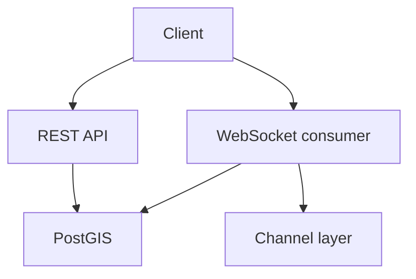

# 🗺️ EuroRace Backend

**A geospatial event backend for participant location reports and tasks.**

The project combines Django REST Framework, GeoDjango/PostGIS and Django Channels. It demonstrates API development and spatial data handling alongside the computer vision projects in my [portfolio](https://korniszon99.github.io/korneliusz.musial/).

## What to explore

| Component | Source |
| --- | --- |
| Location data model | [models.py](backend/eurorace/models.py) |
| REST endpoints | [views.py](backend/eurorace/views.py) and [urls.py](backend/eurorace/urls.py) |
| Real-time location handling | [consumers.py](backend/eurorace/consumers.py) |
| WebSocket tests | [tests.py](backend/eurorace/tests.py) |
| Container services | [docker-compose.yaml](backend/docker-compose.yaml) |

The channel layer uses in-memory storage in debug mode and Redis otherwise. Tests include WebSocket communication and location persistence. Their presence is not a claim of production readiness or a recent passing run.

## Run and inspect

Start with the [current setup guide](backend/README.md). It explains local configuration, the actual Docker services and the test command. [API documentation](backend/API_DOCUMENTATION.md) is available for further inspection; check it against the route definitions when integrating a client.

**Status:** development project. The settings currently include development defaults and permissive host/CORS configuration. Before any public deployment, configure a new secret from the environment, restrict hosts and origins, use HTTPS, review permissions and location-data retention, and validate authentication. This documentation update does not certify those deployment changes as completed.
